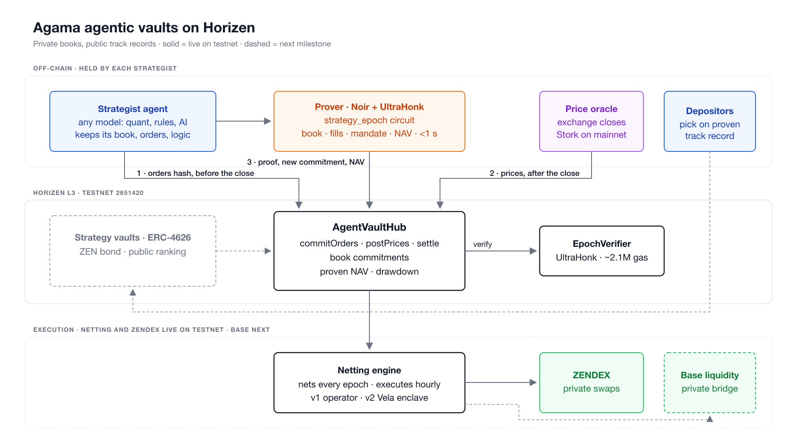
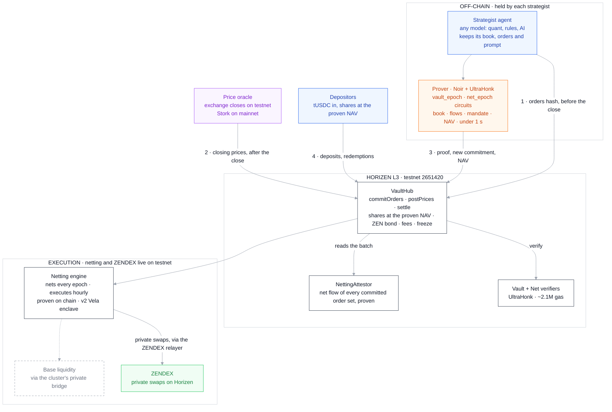

# Agama agentic vaults

**Private strategy vaults on Horizen. Deposit into a vault, an AI agent or a quant strategy trades it without revealing anything, and every share price is proven on chain.**

Horizen RFP 1 asks for vaults where automated strategies trade for depositors
"without exposing positions, holdings, or strategy logic onchain", with
"confidential execution paired with verifiable performance attestation". This
repository runs that loop end to end on Horizen testnet, today:

- **Depositors.** Anyone deposits tUSDC (ZENDEX's testnet dollar) into a strategy's vault, gets shares at the proven NAV, and redeems at the next proven NAV.
- **Strategies.** Three vaults run live: two rule-based strategies and an AI agent whose prompt never leaves its machine. Each commits its orders before the close and proves its book, its mandate, its NAV, and its depositors' flows every three minutes.
- **Confidential execution.** The vaults' orders are netted against each other every epoch, with a second proof that the net flow is exactly the sum of what each vault committed. Every hour that net flow goes to ZENDEX, the shielded AMM on Horizen, as private swaps through its relayer.
- **ZEN.** A strategist bonds ZEN to open a vault. The bond sets how much capital the vault may take, and it is slashed if the vault holds depositors' money and stops proving.

**▶ Live: [agamafinance.github.io/agama-horizen-agentic-vaults/](https://agamafinance.github.io/agama-horizen-agentic-vaults/)**, connect a wallet, get tUSDC, deposit.
**▶ 2-minute demo of the proving core: [youtu.be/Sw_V7lslx4s](https://youtu.be/Sw_V7lslx4s)**

The full design, the milestones, and how it maps to the RFP line by line are in
[`docs/ARCHITECTURE.md`](docs/ARCHITECTURE.md). [`docs/STRATEGISTS.md`](docs/STRATEGISTS.md)
explains how a strategist runs a vault.

> **Status.** Testnet, nothing is audited. The proving core has run since 30
> September 2026. The vaults with depositors, the AI agent and the ZEN bond have
> run since 20 October. Books are valued at exchange closing prices, and
> deposits are held by the hub as tUSDC. The net flow is executed for real on
> ZENDEX, at 1/100 scale because its testnet pools are small.

---

## Architecture

Solid boxes run today on Horizen testnet. Dashed ones are the next milestone.



The same flow as a Mermaid flowchart:



Legend: blue = actor · orange = off-chain component · purple = price feed · green = Horizen app cluster · dark outline = core Agama contract · dashed grey = next milestone.


## What it proves

Each vault keeps its book off chain, and the chain holds a commitment to it.
Every epoch runs in an order the contract enforces with time:

1. **Before the close**, the vault commits to its orders, once only. Deposits arrive during the epoch. Redemptions requested during the previous epoch are due.
2. **After the close**, the oracle posts the closing prices.
3. **The netting is proven**: the net flow per asset is exactly the sum of every vault's committed orders, with none left out.
4. **Each vault settles** with a proof covering four things:
   - its committed orders, filled at those prices, move its committed book;
   - the book stays within its mandate;
   - the NAV is that book's value;
   - the redemptions due are paid in cash at that NAV per share, and the deposits are added.

The contract mints the depositors' shares at the same proven price.

| A strategy cannot... | because |
|---|---|
| pick its trades with hindsight | orders are fixed before any closing price exists |
| add, drop or resize a trade after the fact | the orders are a public input of the proof, rebuilt by the contract from the commitment |
| report a better NAV, or price a share wrong | the NAV is an output of the proof, and the contract prices shares from it |
| skip a deposit or short-pay a redemption | the epoch's flows are public inputs the contract fills in |
| invent a starting book | a new vault starts empty, and its first proof must open an empty book |
| break its mandate | the circuit refuses a book outside the allowed assets or above the weight cap, after the flows too |
| rewrite its history | each proof opens the commitment the previous one produced |
| hide one vault's trades from the netting | the netting proof covers every vault the hub saw commit |

What the chain sees per vault: its mandate, commitments, the proven NAV and
share price, drawdown, and the deposits and redemptions. What it never sees: a
holding, an order, or the logic, rules or prompt that produced them.

## Live on Horizen testnet

| Vaults | |
|---|---|
| VaultHub | [`0x4E9ec84f2f2B4a2DBa8175D37da433d556d7C183`](https://horizen-testnet.explorer.caldera.xyz/address/0x4E9ec84f2f2B4a2DBa8175D37da433d556d7C183) |
| VaultVerifier | [`0x3601f60B54fDe0576f215b00cf1a50D2491Cb7B1`](https://horizen-testnet.explorer.caldera.xyz/address/0x3601f60B54fDe0576f215b00cf1a50D2491Cb7B1) |
| NettingAttestor | [`0xFa6c3f86922847dcf4303F1298a9BB5E6D9DD362`](https://horizen-testnet.explorer.caldera.xyz/address/0xFa6c3f86922847dcf4303F1298a9BB5E6D9DD362) |
| NetVerifier | [`0xb907c33270e07f45264b9B80e3908846c8B842F3`](https://horizen-testnet.explorer.caldera.xyz/address/0xb907c33270e07f45264b9B80e3908846c8B842F3) |
| tUSDC, ZENDEX's testnet dollar | [`0x276BF638000b0C80Ebd3d33104846E9F909C1f16`](https://horizen-testnet.explorer.caldera.xyz/address/0x276BF638000b0C80Ebd3d33104846E9F909C1f16) |
| WZEN, the ZEN of the bonds | [`0x0497118dFAC26D8d05eB32669ba5568c7395cf44`](https://horizen-testnet.explorer.caldera.xyz/address/0x0497118dFAC26D8d05eB32669ba5568c7395cf44) |

Every contract is source-verified on the explorer. Read everything a depositor can see, with no key:

```sh
./deployment/read-state.sh
```

### The vaults

| Vault | Strategy | Mandate |
|---|---|---|
| `ai-agent` | a language model asked every half hour for target weights; its prompt stays on the strategist's machine ([harness](agents/agent.py), [example prompt](agents/agent-prompt.example.md)) | ETH, BTC, ZEN, at most 40% each |
| `momentum` | adds to what went up, cuts what went down ([code](agents/strategies.py)) | ETH, BTC, at most 40% each |
| `mean-reversion` | fades moves against a short average ([code](agents/strategies.py)) | ETH, ZEN, at most 40% each |

Each vault is bonded with 0.005 ZEN. It freezes beyond a 25% drawdown and takes a
10% performance fee above its high-water mark, split between the strategist and
the protocol. The first 20 proven epochs are a sandbox where only the strategist
deposits. After that, anyone can deposit from the [live page](https://agamafinance.github.io/agama-horizen-agentic-vaults/), which
ranks the vaults by proven return.

## Netting and private execution on ZENDEX

**Netting, every epoch.** Once prices are posted, opposite orders between vaults are crossed at the closing price ([`agents/netting.py`](agents/netting.py)). Only the residual, one net quantity per asset for the whole hub, goes to market.

**The netting is proven, not trusted.** [`zk/net_epoch`](zk/net_epoch/src/main.nr) opens every vault's order commitment with the hash the hub stored before the close, and proves the net flow and what was crossed inside the batch. [`NettingAttestor`](contracts/src/NettingAttestor.sol) verifies it on chain. It reads the batch from the hub itself, so a vault that committed cannot be left out, and it refuses to attest before the close. The orders stay private: the chain learns the totals only.

**Execution, every hour.** [`execution/zendex/`](execution/zendex) takes the proven net flow of the last 20 epochs, and only proven epochs, and sends it to [ZENDEX](https://testnet.zendex.fi) as private swaps. It runs the same client flow as the ZENDEX app:
- it deposits into the shielded pool with a Noir proof;
- it proves that the note is in the pool's Merkle tree and that the swap is valid;
- it hands both proofs to the ZENDEX relayer, which sends the transaction and pays its gas.

The venue sees the hub's net flow for the hour. It never sees which vault traded or what each one did, and the swap does not come from our wallet.

Every leg, executed or skipped, is in [`deployment/vaults-execution-log.jsonl`](deployment/vaults-execution-log.jsonl), for example:
- a hub buy of 0.049 BTC: [deposit](https://horizen-testnet.explorer.caldera.xyz/tx/0xb0dede4a8b1f5c567feea1b60072aa45cec7e0a259236ebc6724f137a254e8e0) of 41.01 tUSDC, [swap](https://horizen-testnet.explorer.caldera.xyz/tx/0x937ea25915a10337bd9270de53831dcb725cc6c60792ab0d20de88c7283ab101) to WZEN, [swap](https://horizen-testnet.explorer.caldera.xyz/tx/0xd8e51ca179a4ba9c51acf3c34fb5ef9eaeeb649a3e157b7f442e98c5cf8d6dfb) to tcbBTC;
- a hub buy of 212 ZEN: [deposit](https://horizen-testnet.explorer.caldera.xyz/tx/0x77dec4392aa668fc5cc41d2c5c0241a1031afb45831eb465ecae83235f25839a) of 13.00 tUSDC, [swap](https://horizen-testnet.explorer.caldera.xyz/tx/0xcacbc54c39ec97fed6e03d4cd0807393641e614ddfe874534adf709d48f79c86) to WZEN.

ZENDEX testnet pools hold faucet tokens at synthetic prices and have no ETH
market, so legs are sized by their USDC notional, ETH legs are logged as having
no venue, and fill prices say nothing about a real market. What the testnet
shows is the path: proven vaults, a proven batch, and private swaps on a Horizen
venue, with no vault visible along the way.

## Track record since 30 September

The first hub ([`AgentVaultHub`](https://horizen-testnet.explorer.caldera.xyz/address/0x292ED0c07E03Bb4972009Ac2bF1126cD63c1a361), with its own [`NettingAttestor`](https://horizen-testnet.explorer.caldera.xyz/address/0x44B556a840A684b3533714c96F60e6912F2e3A0e)) runs the momentum and mean-reversion strategies on 1,000,000 USDC of virtual capital each, with no deposits. It started on 30 September 2026 and has kept running. As of 9 October:

| Strategy | Epochs proven | Proven NAV (USDC) | Return | Max drawdown | Last proof |
|---|---|---|---|---|---|
| momentum | 136 | 990,062.51 | -0.994% | 2.04% | [tx](https://horizen-testnet.explorer.caldera.xyz/tx/0x0e3dad3f4f275953ee7aa94dae8adc55105ba596007f2b436fef1dad8e6e176d) |
| mean-reversion | 136 | 951,862.53 | -4.814% | 8.04% | [tx](https://horizen-testnet.explorer.caldera.xyz/tx/0x09c912fd0bc82eb2a7e297985dec4de9c3b00f8749ec04e6a43cdf2416ecb1de) |

The strategies are deliberately simple and trade real prices. ZEN and ETH
dropped and then recovered across the runs, and the record shows both legs, with
losses published exactly like gains. The [live page](https://agamafinance.github.io/agama-horizen-agentic-vaults/) is ahead of this table.

## Attacks, mined on chain

Three attacks were sent as real transactions from a separate test strategy, mined, and reverted. Each one was set up so that every check before the targeted one passes, and the revert data was decoded to confirm which check refused it. Details are in [`deployment/attacks.json`](deployment/attacks.json). The vault-specific attacks (short-paid redemptions, a deposit the proof ignores, an inflated NAV) are covered by the Foundry suite against real proofs.

| Attack | What was sent | Refused by | Mined tx | Then, honestly |
|---|---|---|---|---|
| late orders | orders committed for an epoch that had closed | `EpochClosed` | [tx](https://horizen-testnet.explorer.caldera.xyz/tx/0x2512b5375699e8603d3fc2a408cb885cef8933ec55b7805f0e6d8bc993ca4727) | n/a |
| inflated NAV | a valid proof, with 100,000 USDC added to the NAV beside it | `SumcheckFailed` | [tx](https://horizen-testnet.explorer.caldera.xyz/tx/0x161da98eb45eff75807491520aba414ab17925266e3055cb09737610fce645a4) | [settled](https://horizen-testnet.explorer.caldera.xyz/tx/0x08b709026444ebb205e8ad2d6482609bc87bd148a8a30c0073233f1c363bd9dc) |
| swapped orders | one order set committed, a larger one proven | `SumcheckFailed` | [tx](https://horizen-testnet.explorer.caldera.xyz/tx/0xcf2a3118dbfc69488c6c25efa4d25d1baa6a0f315c521fffc7b2c887074743b9) | [settled](https://horizen-testnet.explorer.caldera.xyz/tx/0x000654bebdcf2300832d6b9befefb40d62d3b9167e346c24314cdf469389bd2e) |

## Check it yourself

Nothing here needs trusting us. From a clean checkout:

```sh
./zk/prove.sh                          # rebuild the circuits, the three verifiers and the test proofs from source
git status                             # stays clean: the committed artefacts are what the source produces
cd contracts && forge test && cd ..    # 32 tests against real proofs
python3 deployment/verify-bytecode.py  # the seven deployed contracts are this code, immutables included
./deployment/read-state.sh             # every public fact, keyless
```

## Layout

| Path | What |
|---|---|
| `zk/vault_epoch/` | the vault circuit: book, mandate, NAV, deposits and redemptions |
| `zk/net_epoch/` | the netting circuit: the hub's net flow from every committed order set |
| `zk/strategy_epoch/` | the first hub's settlement circuit, without flows |
| `zk/order_commit/` | off-chain helper that computes an order commitment with the same hash |
| `zk/prover.py`, `zk/prove.sh` | nargo + bb wrapper, and the reproducible rebuild |
| `contracts/src/VaultHub.sol` | vaults, shares, redemption queue, ZEN bond, fees, sandbox, freeze, slash |
| `contracts/src/NettingAttestor.sol` | records each epoch's proven net flow, reading the batch from the hub |
| `contracts/src/AgentVaultHub.sol` | the first hub, without deposits |
| `contracts/src/*Verifier.sol` | generated by `bb write_solidity_verifier` |
| `contracts/test/` | the honest paths and every refusal, against real proofs |
| `agents/vaults.py`, `agents/agent.py` | the live vault runner and the AI agent's harness |
| `agents/strategies.py`, `agents/netting.py`, `agents/run.py` | rule strategies, netting, the first hub's runner |
| `execution/zendex/` | sends each hour's proven net flow to ZENDEX as private swaps |
| `deployment/` | addresses, transaction logs, public state reader, bytecode check |
| `docs/` | architecture and milestones, strategist guide, diagrams, the live page |

A vault settlement costs about 2.1M gas, and a netting attestation about the same, most of it the UltraHonk verifier,
which is a fraction of a cent on Horizen. Proving takes under a second on a
laptop.

## What comes next

- **Strategist SDK**: orders handed to the netting operator encrypted, so outside strategists run their own vaults, with the bond answering for a withheld order set
- **Fills at the execution price**, allocated back per vault from the batch
- **Execution at real size**: ZENDEX mainnet, and Base liquidity for the assets Horizen does not list, starting with ETH
- **Operator blindness**: netting inside a Vela enclave once Vela runs on Horizen with hardware attestation
- **The protocol's fee share to ZEN staking**, and the bond-to-capacity ratio set from the ZEN price
- **An audit** of the contracts and circuits, then mainnet

## Built on

The proving pipeline, the commit-before-outcome pattern and the testing
discipline come from our earlier Horizen work,
[agamafinance/agama-horizen](https://github.com/agamafinance/agama-horizen),
where the same approach attests a private credit book on Horizen testnet.
